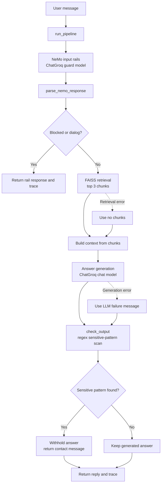

# Pipeline Flow

## Notes

- The input guard uses NeMo rails. A blocked request or a dialog response returns before retrieval and answer generation.
- If retrieval fails, the pipeline continues with the fallback context: "No relevant policy excerpts were retrieved."
- If answer generation fails, the pipeline checks the failure message with the output guard like any other answer.
- The output guard is the regex-based `check_output()` scan against `SENSITIVE_OUTPUT_PATTERNS`; matches cause the generated response to be withheld.
- `needs_rag` is parsed from the NeMo response but does not currently control whether retrieval runs.